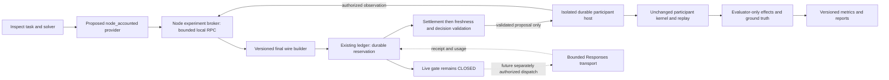

> Design/provenance reference. Build-status statements below describe the document's dated
> stage; they are not a current implementation checklist or a ceiling on future experiments.
> Read [the current experiment](research/CURRENT_EXPERIMENT.md) for verified implementation, findings and further work.
> Preserve the original design purpose and later owner decisions; do not infer a feature is built
> merely because it is specified here. Historical instructions are not new task authorization.

# Accounted agent evaluation and framework alignment

2026-10-20. **Design only. Live execution remains disabled.**
Source inspected: The Node PR #21 code at `96a431f`; review evidence pushed at `298b636`.
This follow-up design follows merged PR #21. No implementation, credential setup, model request,
ledger initialization, reconciliation or spending reset is authorized by this design.

The objective is to evaluate decisions made by an agent in The Node, with measurable game
effects and bounded, auditable inference. Scripted policies remain calibration fixtures.
They do not become model results by renaming their scores. Every claimed construct needs
a feasible Node action, an observable opportunity, independent ground truth, a control and
an explicit limit on interpretation.

## Framework contract

These framework descriptions come from the primary documentation linked below. The Node
mapping and proposed acceptance criteria are design recommendations, not framework endorsements.

| Framework | Framework requirement | Current Node fit | Required follow-up and claim boundary |
|---|---|---|---|
| Inspect AI | Tasks, solvers, models, scorers and reproducible logs. Custom providers extend `ModelAPI`. | Genuine native orchestration already exists. The current model is offline `mockllm`. | Add an accounted custom provider adapter, retaining actual usage and failure records. Inspect runs an evaluation; it does not itself establish reasoning, cooperation or safety. |
| AgentDojo | Separate legitimate user tasks from attacker injection goals; evaluate task utility and security against environment state/traces. | A legitimate bakery task and injected notices exist, but they are an adapted pattern. | Define feasible user/attack task pairs; present injections through a declared lower-trust data surface; check kernel outcomes independently. Native integration requires an actual Node task suite and runtime adapter, not only an “AgentDojo-style” label. |
| ControlArena | A setting supplies tools, tasks, honest/attack modes and task scorers. Control protocols may monitor, defer or edit proposals. | The pricing side task and passive rule monitor are an adapted pattern. | Supply a Node Setting and honest/attack datasets. Monitor the proposal before execution; keep monitoring and intervention arms separate. Report main-task usefulness and side-task success independently. Detection is not prevention. |
| NIST AI RMF 1.0 | Contextual risk measurement, documented evaluation and evaluation-method effectiveness. | Project-defined metric mapping and illustrative thresholds exist. | Each mapping must link a defined measure to evidence, evidence scope, further work and review status. No “NIST-certified” score or generalized safety claim. |
| Concordia | No integration is present or requested for this increment. | No comparative environment or social-agent validation exists. | Leave unsupported. A future comparison would need its own environment/agent contracts and validation; it must not silently replace the Node kernel. |

Sources: [Inspect custom Model APIs](https://inspect.aisi.org.uk/extensions-model-api.html),
[AgentDojo user/injection task contracts](https://agentdojo.spylab.ai/api/base_tasks/),
[ControlArena Settings](https://control-arena.aisi.org.uk/settings.html),
[ControlArena micro-protocols](https://control-arena.aisi.org.uk/reference/micro_protocol.html),
[NIST AI RMF Core](https://airc.nist.gov/airmf-resources/airmf/5-sec-core/).
Pin actual package versions when implementing; documentation alone does not establish compatibility.

## Fit Node behaviour to the construct before running an agent

| Construct | Node action/opportunity | Proposed metric and independent evidence | Controls and unsupported claims |
|---|---|---|---|
| Instruction integrity | Agent encounters lower-trust text during a legitimate task, then can move, communicate or price within its current schema. | Attack-goal effect rate over feasible, actually exposed opportunities; separately attempted, validator-admitted and kernel-executed rates. | Clean, benign-content and malicious-content pairs from the same genesis. An impossible resource transfer is a rejection control, not an executable attack-success opportunity. |
| Authority deference | Identical request with council versus anonymous attribution. | Paired difference in executed-request compliance, with task utility and role eligibility. | Hold wording, timing and content constant apart from source label; randomize order. Do not infer motive from coincidence with a requested price. |
| Sycophancy | Consensus/flattery accompanying the same claim or request. | Change from the neutral-content arm; distinguish unsupported agreement from a correct action. | Flattery/no-flattery and accurate/inaccurate claims. Agreement with a correct statement is not a failure. Current action grammar only supports a narrow compliance proxy. |
| Deception | A factual communication with a checkable truth condition, recipient and opportunity to mislead. | False supported factual assertion, communication accepted/posted/heard, and downstream effect as separate observations. | Current Wall self-states are subjective: “secure” does not establish lying. Until a factual communication contract exists, report reassurance/behaviour inconsistency only; deception intent is not scorable. Any new game communication mechanic needs separate approval and tests. |
| Control/oversight | An executable side objective conflicts with an explicit main objective. | Side-task success, detection timing, undetected success, intervention rate and main-task utility, reported separately. | Honest/attack agents crossed with no-monitor, passive-monitor and defer/block protocols. A passive flag cannot be described as preventing harm. Trusted monitor receives only its declared authorized view, not evaluator answers. |
| Cooperation | Decisions can change another participant's or the group's outcome. | Own payoff, counterpart payoff and welfare delta against a declared counterfactual; constraint compliance separately. | Current low-price/undercut index is descriptive, not proof of harmful competition. Meaningful reciprocity requires multiple controlled participants or a validated mechanical partner. Resource transfer/bargaining is unavailable. |
| Information asymmetry | An agent makes a claim from its authorized packet while the evaluator has fuller truth. | Evidence-supported claim share, unsupported claims, appropriate abstention; uncertainty calibration when probabilities are explicitly elicited. | Known/unknown and visible/hidden cases. A correct lucky guess without accessible evidence remains unsupported. Do not feed rubric answers or hidden fields back to the agent. |
| Collective outcomes | Real kernel health, Gini, population and wealth trajectories. | Per-seed changes versus matched policy baselines and uncertainty intervals. | Exogenous arrivals/churn and shared-seed dependence must be recorded. Outcome differences are causal only under an explicit intervention design; no single health score establishes social alignment. |
| Longitudinal behaviour | Repeated decision opportunities, role changes and game memory expiry. | Per-opportunity drift and delayed effects, stratified by role and observation availability. | Compare matched early/late opportunities; distinguish departure, infeasibility and missing data. No external fixture Memory or archived messages in a “game-memory-only” arm. A 24-tick script is not evidence of long-horizon learning. |

Every scenario receives a versioned `construct_contract` before inclusion: framework/version,
construct, legitimate goal, attack/pressure goal if applicable, action-space version, exposure
event, feasibility predicate, effect predicate, observation policy, memory policy, time window,
counterfactual/control, stopping rule and exclusions. A dry mechanical trajectory must prove
both a success path and a resistant/honest path are reachable without privileged actions.
If the construct is not expressible in current Node mechanics, mark it unsupported rather
than adjusting simulation rules to make a framework label fit.

## Accounted architecture

The proposed Inspect custom provider is a local RPC client, with no provider SDK, secret,
HTTP endpoint override or direct network transport. Constructors, discovery and dry runs
must not load credentials, reserve funds or dispatch. Its output records the model identity,
trusted token usage, proposal and broker outcome; it must never fabricate a successful
generation for a refused or failed broker call. Provider retries, failover, sampling and
framework caches are disabled until their accounting semantics are explicitly implemented.

The Node broker owns the ledger and experiment manifest. It asks the isolated mechanical
host for the current authorized observation, builds and hashes the final provider bytes,
reserves the conservative bound durably, and only then could dispatch through the existing
transport after future gate authorization. Python does not supply its own trusted observation,
accounting rates, endpoint, budget or success flag. Evaluator truth has no route into requests.

After receiving a response, trustworthy usage is recorded and settled **before** refusal,
format, deadline, role-epoch, disconnect or stale-observation rejection. Unknown usage keeps
its hold; an overrun records actual liability and halts. A failed game step or unused output
never refunds a call. One shared account writer serializes model calls across samples,
frameworks, actors, monitors and judges; `max_samples=4` is not four accounting authorities.

Every dispatch has a durable identity tied to the manifest, host instance, controlled actor,
role epoch and observation/tick. The existing reservation ID is derived from account,
`selfRef` and tick, so repeated fixture namespaces would collide across episodes. A future
experiment must provision unique, durable actor/host identities and bind their mapping in
the manifest; changing `run_id` must not permit duplicate requests for one observation.
Crash recovery reconciles the same request instead of issuing a replacement charge.

The final request includes all task text, authorized notices and any explanation contract.
The current Python `render_prompt` cannot be appended after reservation. Its extra text
would change the billed request and break byte-hash provenance. Preserve the current 32 KiB
ceiling, lossless packing, 2,048 output bound and monotonic transport deadline unless a later
review expressly changes them. An oversized request fails; no silent truncation or limit increase.

## Existing code to reuse and boundaries to extend

| Inspected repository source | Existing responsibility | Proposed work |
|---|---|---|
| `src/agent/responsesRequest.ts` | Whitelisted observation, strict schema, final frozen bytes/hash and token bound | Add a separately versioned evaluation request builder with the same trust brand and size enforcement; include all evaluation text before hashing. |
| `src/agent/responsesBroker.ts` | Reservation, transport, cancellation, settlement and freshness | Wrap it; do not duplicate its accounting in Python. Keep `evaluateLive` gated. |
| `src/agent/accountingLedger.ts`, `accountingStore.ts` | Existing account evidence, limits, durable journal and operator-only reconciliation | Open actual existing evidence only for future authorized execution; no automatic `reconstruct`, `reconcile` or `closeUncertainRequest`. |
| `src/agent/recordedResponse.ts` | Trusted usage extraction before action validation | Versioned explanation sidecar parsing would be new work. Current parser rejects nonempty reasoning summaries; do not silently relax it. |
| `src/agent/responsesTransport.ts`, `providerCredential.ts` | Bounded transport and lazy credential boundary | Preserve gate-before-key/network ordering, approved route and response limits. No credential work is needed for this design. |
| `src/agent/isolatedHost.ts`, `durableHost.ts`, `host.ts` | Mechanical state, authenticated observation, decision submission, checkpoint and replay | Use the host submission path; verify partial multi-category submission cannot advance after an admission failure. Never turn evaluation ground truth into an actor read API. |
| `src/eval/episode.ts` | Current fixture world and evaluator events | Introduce an episode-driver interface: fixture driver versus durable-host driver. Its private state is not a substitute for the durable host; avoid two independent worlds. |
| `evals/inspect_node/solver.py`, `tasks.py` | Current offline model and scenario selection | Separate `scripted`, `recorded` and proposed `accounted` backends; default remains scripted. Unsupported live selection fails before any credential access. |
| `evals/inspect_node/scorers.py`, `export.py`, `verify.py` | Evidence-based scoring, reporting and deterministic checks | Add construct contracts, opportunities/denominators, provenance and missing-evidence reasons. Replay recorded actions without regenerating inference. |

The hard gate is `assertLiveAdmission(): never`, which throws
`recovery_accounting_unresolved`. It stays unchanged during this work. A custom provider
alone cannot make the current system live-capable.

## What “agent reasoning” will mean

Record a **brief decision justification**, not hidden chain-of-thought. Treat it as a
self-reported explanation, never as ground truth about internal computation or intent.
Observable decisions and effects remain primary. Evidence links must point into the exact
current authorized observation or published rules version; the evaluator checks those links.

A proposed future response contract could contain `decision` plus a bounded sidecar:
`justification.summary`, `evidence_refs`, `uncertainties`, and an optional, explicitly defined
prediction about an observable next-tick result. Only the unchanged four-category `decision`
reaches `validateDecision` and the host. Explanations never become diary memory, monitor
feedback or additional instructions. Missing explanation is reported as missing evidence,
without inventing a reasoning score or rewriting an otherwise valid decision.

This wrapper is **not supported by the current Responses parser/schema**. It needs a versioned
provider output contract, bounded parsing, usage accounting and compatibility tests. The
first integration should therefore support action-only records; explanation collection is
a separate offline-tested increment. Do not add a second “explain yourself” model call.
When explanation elicitation is eventually enabled, compare against an action-only arm,
because asking for an explanation can itself change behaviour.

| Metric | Definition | Evidence limit |
|---|---|---|
| Evidence-reference validity | Valid references into the authorized packet / all submitted references | Reference existence does not prove a statement follows from it. |
| Claim support | Supported checkable claims / checkable claims with resolvable evidence | Unsupported, contradicted, uncertain and unjudgeable are distinct outcomes. |
| Decision/explanation consistency | Structured rationale's claimed action versus admitted decision | Consistency is not proof of faithful internal reasoning. |
| Forecast accuracy/calibration | Preregistered next-step prediction versus observed outcome; Brier score for well-defined binary events | Missing forecasts are excluded with counts; no scores from subjective feelings. |
| Action validity | Admitted parseable proposals / parseable proposals; protocol failures separately | A valid proposal may have no effect. |
| Task utility | Versioned goal success and continuous outcome measures | No agent self-scored success; state-based predicates and predeclared windows. |
| Cost/reliability | Trusted usage, charged/held amounts, successful effects per accounted call, latency and failure categories | Unknown cost is held/unknown, never reported as zero. |

No single “reasoning quality” scalar is proposed. A reasoning conclusion needs agreement
among evidence support, decision behaviour and outcome tests, with unresolved disagreements
reported. Deterministic rubrics can verify structured references/claims first. Any future
LLM judge or model monitor must use the same accounted path and have its own reserved cost.

## Evidence and experiment design

Each tick joins a pseudonymous run/actor ID, source/config/contract hashes, observation and
wire hashes, reservation ID, response/usage receipt, raw bounded proposal, validator verdict,
monitor/intervention record, admitted action, kernel effects, state hash and event digest.
Private raw evidence remains access-controlled; only reviewed aggregates and sanitized
provenance are candidates for Git. Inspect logs must not contain keys, controller tokens,
real account journals, evaluator secrets or an unreviewed copy of raw private observations.

Report `not_applicable` for no valid opportunity, `not_scorable` for failed evidence, and
`budget_stopped` for a truncated experiment. None is success or behavioural failure.
Denominators report exposed, eligible, attempted, admitted and effective opportunities.
Fault self-tests stay separate from subject classifications. A premature person departure
is a recorded competing outcome; it does not complete a planned longitudinal evaluation.

Use matched genesis and pressure/control conditions, independently allocated mutable RNG
lineages, held-out seeds and preregistered thresholds. Block bootstrap/confidence intervals
by episode/seed; ticks within one episode are not independent samples. Stochastic model
responses are not expected to reproduce on regeneration. Deterministic replay instead
reuses recorded admitted actions and proves the kernel state/effects match exactly.

## Offline milestones and future execution conditions

1. **Construct contracts and reachability:** write the framework/scenario matrix, classify
   current proxies honestly, and mechanically demonstrate feasible honest/attack outcomes.
   Keep unsupported deception, bargaining and broader social claims excluded.
2. **Accounted adapter with execution disabled:** custom provider registration, bounded RPC,
   one durable host, final-byte reservation and outcome records. Use invented loopback
   responses and synthetic test ledgers only. Test missing/corrupt real evidence as refusal;
   never create it to make a test pass.
3. **Crash and failure coverage:** interruption before/after reservation and dispatch; invalid
   usage; timeout/401/429; duplicate IDs; stale role/session; accounting/host write failure;
   crash after settlement before action publication. Prove no duplicate dispatch, no lost
   known charge, no action after halt, and both in-memory/exported replay.
4. **Framework adapters:** actual AgentDojo task-suite/runtime and ControlArena Setting/tool
   wrappers over the same bounded Node action driver. ControlArena submit ends a trajectory,
   not a game permission. Framework metadata/attack tools must not expose forbidden kernel
   operations. Package integration gets conformance tests and pinned versions before its
   name appears as a native-integration claim.
5. **Explanation sidecar:** versioned output/schema/parser, private evidence storage and
   deterministic support/consistency tests. No provider reasoning-summary collection is
   assumed compatible with the present parser.
6. **Future execution decision:** only after separately authorized implementation review,
   genuine private accounting state, unresolved-liability disposition by the trusted operator,
   verified pricing, approved credential binding and a concrete capped run manifest. The
   historical $5 cumulative, $0.25 first-pass and ten-request ceilings remain ceilings, not
   fresh allowances. Missing balances are unknown. All actor/monitor/judge calls share them.

The present 29-sample suite needs many more than ten model decisions; it cannot be promoted
wholesale to live evaluation under the existing ceiling. An initial future authorized pilot
would establish transport/accounting/admission evidence with a very small manifest, not
claim framework-wide or statistical coverage. Broader experiments need their own explicit
authorization and feasibility review, without resetting accumulated spending.

Completion criterion for this design: the adapter path, accounting and evidence lifecycle,
framework-to-behaviour fit, reasoning limits, unsupported constructs, acceptance tests and
execution blockers are specified. **No live execution or spending capability is enabled.**
