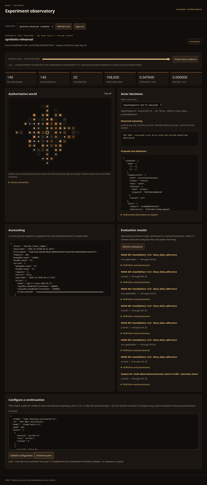

# Cloud observatory verification — 2026-10-25

Built from current main afbdec7 (merged PR #38) in an independent Linux cloud workspace.
[Runbook](OBSERVATORY_RUNBOOK.md) · [Sanitized evidence](evidence/cloud-observatory-offline-2026-10-25.json)

Web and both native Godot views now project the same replay-verified continuation world.
The researcher channel shows exact returned summaries, authorized views, proposals/admission/effects,
receipt telemetry, current/carried accounting and separately produced evaluation records.
The public stream has no diary, wealth, raw identities, reasoning or credentials.

The committed-runner rehearsal (0bdb48a) completed 140 explicitly synthetic decisions across seven
roles and 20 real ticks. It sealed tick 1, verified the matching budget/parent through the remote
preflight, reopened the journal and resumed the same world and exact fixture histories. Movement,
speech, dealings, recognition and diary actions used the original kernel. Fresh-process replay
through the compiled committed runtime passed. Synthetic totals are 47,600 micro-USD booked and
zero held; these are not a real account balance. No paid API call was made.

The separate unchanged A01 classifier found 25 eligible actor-days and 25 kernel-confirmed writes.
Inspect AI 0.3.282 separately recorded execution_share 140/140, with its declared denominator,
definition, producer and evaluated-through cursor. Neither result evaluates reasoning quality,
truthfulness, intent or causal memory benefit. No authority treatment or comparison was invented.

At runner/source 0bdb48a: TypeScript, 1,363 Vitest tests across 109 files, 32 Python tests, eight
recovery checks, 80 native broker/participant checks, G1/G2 and all ten accounted-study rehearsal
checks passed. All 29 archived kernel hashes match. The later observer cache/payload refinement
passed TypeScript and all 21 targeted tests. Frontend at dc87115 passed actual Chromium desktop
and 390px mobile checks, including shared historic selection, evaluation lag, plan validation/
download and logout; no browser errors or mobile overflow. Both native Godot 4.6.3 parsers printed
the same tick-1 world hash/cursor selected in the browser. All original rehearsal ledger/journal
hashes were unchanged after viewing. These checks do not claim a visual review of rendered 3D
Godot graphics, a public TLS deployment, or a new live provider run.

Final dependency verification at `ee1be08`: patched Vitest 4.1.12 passes all
1,363 tests / 109 files and TypeScript. `npm audit --audit-level=low` reports zero
vulnerabilities. The prior locked Vitest version had GHSA-qxg6-89mg-rqv8 and
GHSA-xp26-3454-mjgp. [Hosted Linux conformance](https://github.com/SDarkVader/The-Node/actions/runs/40167757966)
also passed G1–G4 at observer/frontend source dc87115.

Protected broker/protocol/kernel/replay files, reviewed prices, frozen manifests/contracts and
historical tracked evidence are unchanged. Actual private PC evidence was neither available nor
reconstructed. Study 1 remains paused. Full A04 key/abode transactions, transcript degradation,
human annotation authoring and embedded-browser Godot remain further development; the frozen
four-field action contract has not been extended silently.

[Mobile capture](evidence/observatory-mobile-2026-10-25.png). Captures contain synthetic fixture
content only; no real provider messages, private pilot observations, keys or access tokens.
