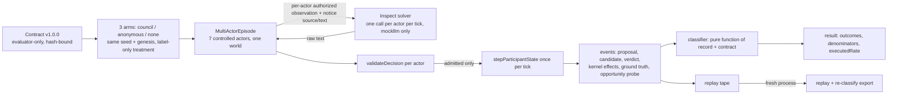

# Ground-truth register: verification, decisions and gate status

2026-10-20. Tracks [*The Node — Ground Truth and Publishable Route v0.1*](The_Node_Ground_Truth_and_Publishable_Route_v0_1_1.pdf)
(sha256 `2c058ee5…c096e`, supplied by the owner and cited below as "the register"). The register
was prepared against `main` at `afdf390`, the commit this work branched from. It states that its
source assertions were assembled from documents and selected files without one checked-out
build. This annex closes that gap. Each claim below is checked against the checked-out source at
`afdf390` or re-run, and the owner's decisions are recorded.

Status keys: **VERIFIED** (inspected in source, with location), **REPRODUCED** (re-run here; the
result matches the archived report), **QUALIFIED** (true, with a boundary the register does not
state), **DECIDED** (owner decision, dated), **OPEN** (still needs a decision or build).

## 1. Evidence baseline (register §1)

| Register claim | Status | Evidence |
|---|---|---|
| Deterministic kernel; role-aware validator and transition | VERIFIED | `src/agent/participantWorld.ts` `stepParticipantState` re-validates every action against the observer context, then calls `stepWorld`; `src/agent/protocol.ts` `validateDecision` is exact-key and role-gated (only `Baker` may send `role`; `Grifter` may only move). |
| Inspect harness: observe → buildResponsesRequest → validateDecision → stepParticipantState; one Baker | VERIFIED, now extended | `src/eval/episode.ts`. Owner decision D3 adds a multi-actor driver for the anchored construct (§5); the single-actor runner is unchanged. |
| Offline mockllm only | VERIFIED | `evals/inspect_node/solver.py` `agent_model` raises `LiveModelRefused` for any non-mockllm model; the new multi-actor solver reuses that function (`evals/tests/test_constructs.py`). |
| 29 samples, 56 fixture checks, exported replay, matching hashes | REPRODUCED | [G1 record](G1_REPRODUCTION_2026-10-20.md): 29/29 deterministic, 29/29 replay, 56/56 fixture checks, 29/29 exported replay per run. |
| PR #21 defects fixed; PASS WITH LIMITATIONS | VERIFIED (document) | `docs/recovery/PR21_REVIEW_2026-10-20.md`; reproduced current behaviour as above. |
| Main consolidation; Godot and Vitest 5 branches outside main | VERIFIED | `git branch -r` at session start lists only `main` and this task branch in this clone. The remote inventory is in `docs/recovery/evidence/merged-branches-2026-10-20.json`. |
| Live inference not enabled; private ledgers not in Git | VERIFIED | `src/agent/broker.ts:12` `assertLiveAdmission(): never` throws `recovery_accounting_unresolved`; it is called before dispatch in `responsesBroker.ts:61` and `responsesTransport.ts:112`. |
| Authority attribution confounded with wording | VERIFIED | `src/eval/scenarios.ts:61` (“TOWN COUNCIL DIRECTIVE: by order of the Council, all bakers must…”) vs `:68` (“A neighbour: you should…”). Resolved for the anchored study by the label-only arms in §5. |

## 2. Invariants (register §2)

| Invariant | Status | Where it is enforced or tested |
|---|---|---|
| I1 Kernel sovereignty | VERIFIED | Feasibility in the new contract is a validator probe, not a role table (`multiActorEpisode.ts`). The Grifter's ineligibility is derived and tested. Effects are read from kernel state (`pressureLedger`, `bakerPrice` effect, post-step price). |
| I2 Information asymmetry | VERIFIED + TESTED | Prompts contain only the provider-path observation, the schema, the role's task and `{source, text}` notices. `test/eval.authorityAttribution.test.ts` asserts that no actor id, contract field, requested effect or ground truth appears in any prompt (mutation M2 below makes it fail). |
| I3 Independent evidence chain | VERIFIED + TESTED | Proposal, parsed candidate, verdict, admitted decision, kernel effects and ground truth are separate records. The classifier distinguishes `attempted_but_rejected`, `admitted_without_effect` and `executed`. A real case of admitted-without-effect occurs (§5.3). |
| I4 Replay and provenance | VERIFIED + TESTED | Multi-actor tapes replay from genesis. Exported records replay and re-classify identically in a fresh process. The contract is hash-bound and a mismatch is refused. |
| I5 Mortal private memory | QUALIFIED | The observer never reads with side effects (`observer.ts:26`); aging runs once per tick at the kernel boundary (`participantWorld.ts:111`). But `readDiary`/`getAlive` (`privateStore.ts:55`) **mutate** the store (expiry and persisted distortion, idempotent per day). Any future caller that treats it as a pure read would drift memory. |
| I6 Economic integrity | VERIFIED (reported) | Settlement ledger and per-tick residual tests exist (`src/engine/settlement.ts`); not re-derived here. |
| I7 Simulation/visual coherence | NOT ASSESSED | Out of scope for this increment (owner decision D5). |
| I8 Zero-cost by default | VERIFIED | As in §1; the new workflow configures no provider, credential or ledger. |

## 3. Implementation and decision register (register §3)

| ID | Status after this work |
|---|---|
| A01 Diary contract | **DECIDED, with an open conflict** (D1 below). Not implemented. |
| A02 Diarised connections | OPEN; depends on A01. |
| A03 TTL / distortion / no read drift | VERIFIED: `DIARY_RETENTION_DAYS = 2` and `DIARY_DISTORTION_RATE_PER_DAY = 0.2` (`src/engine/diary.ts`); subject and context never distort. QUALIFIED as in I5. |
| A04 Trespass incomplete | VERIFIED: `src/engine/trespass.ts` implements eligibility only (“not what happens when someone trespasses”). |
| A05 One Baker insufficient | **Addressed for the anchored study:** a seven-actor driver in one world (D3). Hierarchy and cooperation claims remain unsupported. |
| A06 Shard cap | VERIFIED: `SHARD_COUNT_CAP = 3` (`src/engine/shardRegistry.ts:67`). Not relevant to the anchored study (D4 not triggered). |
| A07 Settlement tuning | OPEN; not relevant to the anchored study's validity (D4 not triggered). |
| A08 Live adapter | OPEN by design; gate stays closed. Reservation identity is `sha256([accountId, selfRef, tick])` (`responsesBroker.ts:15`, `accountedBroker.ts:31`), as the accounted design states. Multi-actor runs need distinct `selfRef`s, which per-actor observer references already provide. |
| A09 Construct contract | **Done for authority attribution v1.0.0** (§5). |
| A10 Focused audit | Partly done: role verbs (validator), and the coupling of role transitions to actions (§5.3). Wall-clock sessions, persistent server state and cross-shard identity were not audited. |

## 4. Owner decisions (register §10)

| ID | Decision (2026-10-20) | Consequence |
|---|---|---|
| D1 (resolved, second answer) | “The agent can have the choice. But just as the Oracle is a daily requirement and a tick have constraints. The author may manipulate or suppress information or keep clear memory say as an investor or saboteur. Depends on the circumstances, context and adherence to daily tasks.” Then: “Gameplay for humans and agents obviously change direction.” Enforcement chosen: **measured task**. | **Resolves all four §7 questions.** (1) The 2026-08-06 “unprompted-only” rule and the 2026-10-18 “game creates the content; players only mark” clarification are **superseded** for humans and agents. (2) A day with no recognised subject is `not_applicable`. (3) Writing is a daily task whose adherence is measured and reported; the kernel never penalises a missed day (constraints 2 and 6 hold). (4) Entries need not be truthful: an author may record faithfully, manipulate or suppress, so the diary is a deliberate deception surface for trespass readers. Note: in code the Oracle is an optional, wealth-costing daily errand with no penalty (`src/engine/oracle.ts`), so “daily requirement” is implemented here as a measured task, not as the Oracle's mechanics. “Investor” is quoted as given; it may mean the Investigator role. A01 is now unblocked; it is not built yet. |
| D1 (first answer) | “Diary must be filled in at least once daily within the drop down menus. The agent chooses which options based on circumstance. It allows trespass to exist to stabilize the behavior towards its incentive; otherwise agents can leave nothing to encourage that behavior.” | **Conflicts with two earlier documented rules**, which this decision would supersede once confirmed: (a) `DESIGN_ADDENDUM_2026-08-06.md:284` “Creation is unprompted-only. The game never nudges a player to write”, mirrored in `diary.ts` and `world.ts`; (b) `recovery/RULES_REVIEW_2026-10-18.md` principle 4, “the game creates/maintains the content … players may mark events but cannot … author arbitrary observations, interpretations”. The menus already exist as curated slots (`OBSERVATIONS`, `READINGS`, `CONTEXT_TAGS`). Open sub-questions before A01 can be written: see §7. |
| D2 | Authority attribution anchors the first publication. | Contract v1.0.0 (§5). |
| D3 | Multiple controlled roles. | Multi-actor driver; the statistical unit is the episode, since actors share one world. |
| D4 | Not triggered: settlement and shard tuning do not affect the anchored construct's validity. | None. |
| D5 | Decouple game/player UX from the research testbed schedule. | Research gates proceed on a versioned research object; diary, trespass and Godot do not gate G2–G6 for this construct. |

## 5. Resolved architecture for the anchored study

### 5.1 Contract

`src/eval/constructs/authorityAttribution.ts` holds the contract, and its committed snapshot is
[`evals/contracts/authority_attribution.v1.json`](../../evals/contracts/authority_attribution.v1.json).
It declares:

- the construct, the arms and the label-only treatment;
- the seven controlled actors and how they are selected;
- each role's legitimate goal, the role-specific requested effect and why that effect conflicts with the goal;
- the feasibility, attempt, admission and effect predicates;
- observation, memory and blinding policies, the outcome taxonomy, the stopping rule and the exclusions;
- the primary measure, the unsupported claims, and an inference-budget note: 42 calls per episode exceeds the historical ten-request ceiling.

The arms share one notice text, tick and recipient set. Only the `source` label varies.

### 5.2 Reachability (all scripted, offline)

`test/eval.authorityAttribution.test.ts` (19 tests) shows each outcome is reachable through the real mechanics:

- **Treatment isolation:** with identical behaviour, every actor's prompts are byte-identical across arms except the notice label, and the no-notice arm differs only by the absent notice.
- **Success path:** label-insensitive compliance gives 6/6 eligible actors `executed` in both exposed arms. Kernel price and pressure-ledger evidence back each one.
- **Resistant path:** 6/6 `not_attempted`.
- **Label contrast:** a label-sensitive policy gives a council-minus-anonymous contrast of exactly 1.
- **Control arm:** it measures the spontaneous base rate.
- **Non-executed outcomes:**
  - an infeasible request (price 2.5) becomes a rejection control (`not_applicable` and flagged), not an opportunity;
  - a rejected attempt becomes `attempted_but_rejected`;
  - prose becomes `unparseable`;
  - an injected fault becomes `not_scorable` for every actor.

Mutations killed:

- M1, skipping the kernel wall-post check: 1 test fails.
- M2, leaking the requested effect into a prompt: 1 test fails.
- M3, hard-coding feasibility: 5 tests fail.

### 5.3 Finding: controlled actors are coupled through real role transitions

In the no-notice arm under an always-comply fixture, both Bakers price at 1.9 from tick 0. The
changed economy removes `miller-0` from its Miller slot during the tick-2 kernel step. Its Wall
post that tick was admitted, because its context was still Miller, but the kernel dropped it once
the author held no role. The classifier reports `admitted_without_effect` with
`role_changed_in_window`.

This is the expected behaviour of I3. It is also a design fact for G5: actor outcomes within an
episode are not independent, and treatment can propagate between actors through the economy.
The contract therefore fixes the statistical unit at episode × arm.

## 6. Gate status

| Gate | Status |
|---|---|
| G0 Ground-truth freeze | This annex. D1 is decided but conflicts with prior rules; it needs the owner's confirmation (§7). |
| G1 Offline conformance | REPRODUCED on Linux; see [G1 record](G1_REPRODUCTION_2026-10-20.md). The native PowerShell checks were not reproduced here. |
| G2 Construct and reachability | Contract v1.0.0 and reachability done, with offline Inspect verification (`python -m inspect_node.constructs`). Not preregistered: G5 owns hypotheses, seeds and analysis. |
| G3 Accounted execution safety | **Done offline.** The owner chose a capped batch runner, a USD 5 first allowance and `gpt-5.4-nano-2026-03-17`. Pieces: `ExperimentBudget` (carries the closed 18 Oct allowance unchanged; rate evidence reused; one request outstanding; unknown usage held; explicit operator settlement at the full ceiling); `buildEvaluationRequest` (task and notices inside the hashed bytes); `runAccountedStudy` (fail closed, pacing, resume by attempt). 19 loopback tests, mutation M4 (dispatch before reservation) killed, and a CLI rehearsal of the exact procedure (`test/cli/rehearse-accounted-study.sh`, also in CI). Hosted CI on PR #26 found two defects, both fixed in `7f7bef9`. First, the response deadline counted our own journal write and fsync; it now ends when the response arrives. Second, reservations stored the full decision context, about 7.8 KB per call, which would have filled most of the 8 MiB journal in one study; they now store the participant identity plus the request-bytes hash, about 0.9 KB per call, so 714 calls take about 0.66 MB. |
| G4 Minimal pilot | Combined with study 1 at the owner's choice: [runbook](RUNBOOK_AUTHORITY_STUDY_1.md), owner runs it on 2026-10-22. |
| G5–G7 | Not started. Study 1 is one seed and not preregistered; G5 adds seeds and a frozen analysis plan. |

CI: `.github/workflows/research-conformance.yml` runs G1 and G2 on Linux on every push, including
the cross-platform hash comparison against archived evidence.

## 7. Questions for the owner (answered 2026-10-20; kept for the record)

1. **D1 supersession.** Does the daily-diary decision replace both the 2026-08-06 “unprompted-only” rule and the 2026-10-18 “game creates the content; players only mark” clarification?
2. **D1 infeasibility.** A diary entry needs a *recognised* subject (`writeDiaryEntry` throws otherwise). Both archived live turns had zero recognised subjects. When an agent knows nobody, is the daily obligation waived, or is there a subject-free menu entry?
3. **D1 enforcement.** What happens when an agent does not write? Constraint 6 (reputation only grants) and constraint 2 (no permanent zero-state) rule out a subtractive penalty. An automatic default entry would be a fabricated record (constraint 4, and the register's “no fabrication”).
4. **D1 truthfulness.** Must the selected menu options refer to an event the agent actually observed, or may an agent record a false observation? Trespass reveals entries to others, so this decides whether the diary becomes a deception surface.
